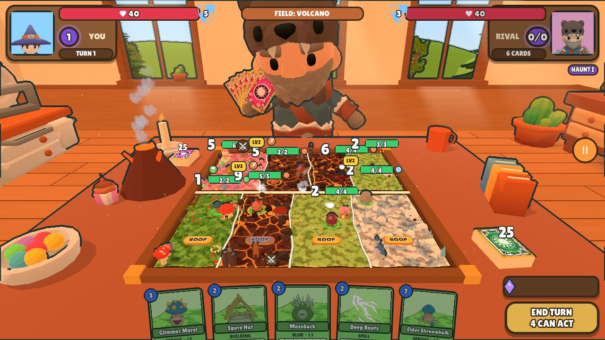
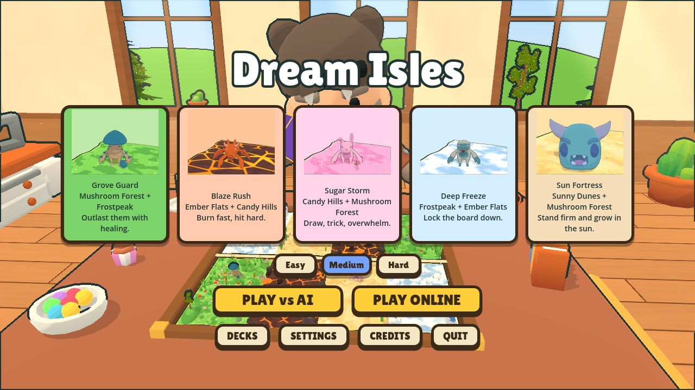
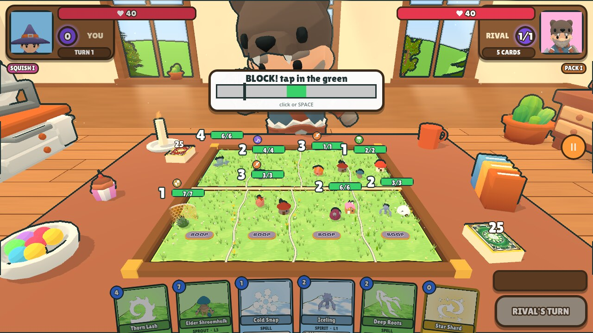
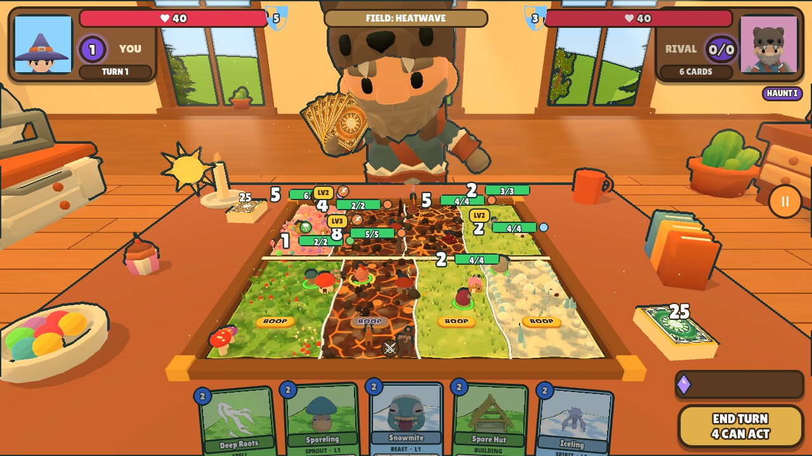
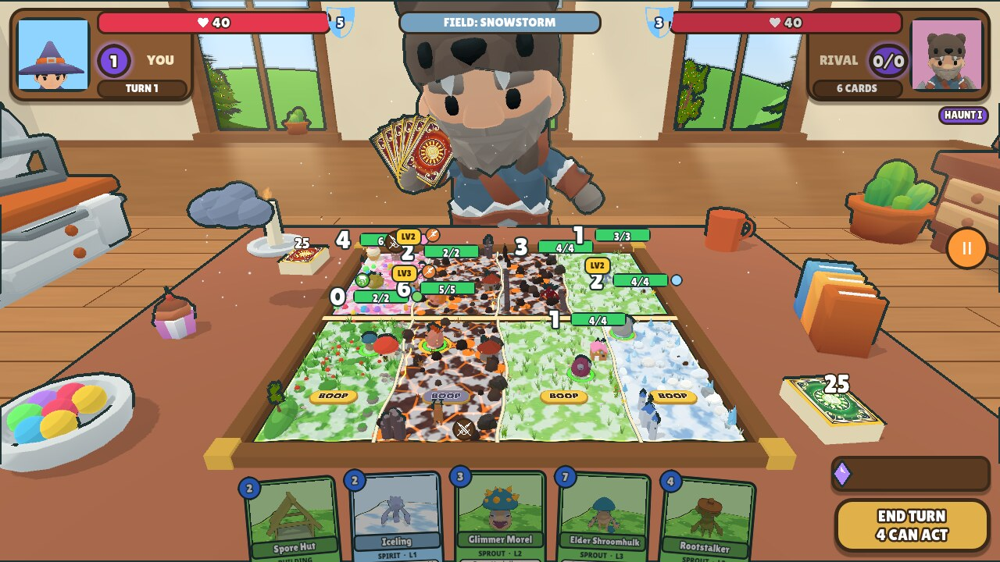
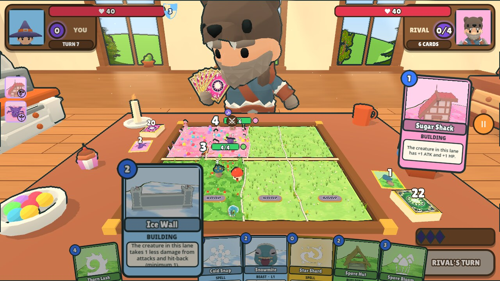
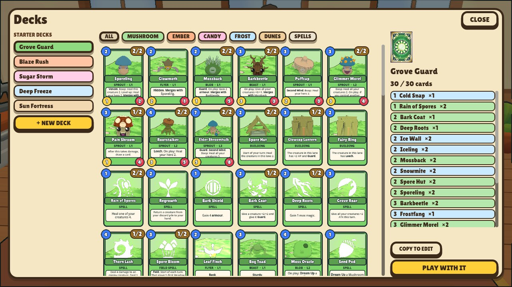
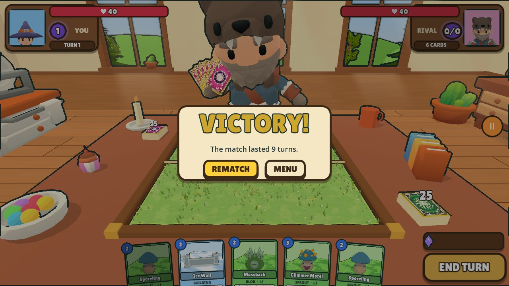

# Dream Isles

**A cosy 3D card battler played on a little tabletop board.** Pick a deck, fill your four lanes with
mushroom critters, lava beasts, candy blobs and frost spirits, and knock your rival's hero from 40
down to 0.

## Play

- **In your browser:** [dream-isles.vercel.app](https://dream-isles.vercel.app). Nothing to install.
- **On Windows:** download `DreamIsles.exe` from the
  [latest release](https://github.com/muriarty1893/cardwards/releases/latest) and double-click it.

Play against the computer (Easy, Medium or Hard), or online against a friend.

## How a match goes

You and your rival sit across a board with four lanes each. Every turn you get a bit more magic to
spend (up to 8), draw a card and then do whatever you like, in any order:

- **Play creatures** into empty lanes. Each lane holds one creature.
- **Play buildings** behind them to boost the creature in that lane.
- **Cast spells** to deal damage, heal, freeze, draw cards and more.
- **Attack** with creatures that have been on the board since the start of your turn. Hit an enemy
  creature (it hits back) or go straight for the rival's hero.
- **Boop** instead of attacking, to trigger a creature's special trick.

The first hero to hit 0 loses.

### Timing matters

Every attack has a bar to tap. Hit the green zone and you land a **critical hit**; miss it and the
blow only glances. When the rival attacks one of your creatures, you get a bar too: tap it in time
to **block** and halve the damage.

### Creatures grow

A creature that attacks and survives gains experience. At level 2 and level 3 it gets stronger,
bigger and a little shinier. Keep your favourites alive!

## The five lands

Every lane starts as an empty meadow. The first creature or building you put there turns it into
its own land, and the ground changes right in front of you. A creature standing on its own land is
**at home** and gets a bonus:

| Land | At home | Style |
|---|---|---|
| 🍄 **Mushroom Forest** | Heals 2 at the start of your turn | Sturdy, lots of healing |
| 🔥 **Ember Flats** | +1 attack | Fast and aggressive |
| 🍬 **Candy Hills** | +1 attack and +1 health | Tricky, draws lots of cards |
| ❄️ **Frostpeak** | Takes 1 less damage | Freezes and locks the board |
| ☀️ **Sunny Dunes** | Your hero gains armour each turn | Tough and patient |

Bigger creatures need more lanes of their land before you can play them, so claim ground early.

Spells react with the land they land on: fire on ice **melts** it, fire in the forest starts a
**wildfire**, fire on candy leaves a creature stuck in **caramel**, and more.

## Fields and weather

Some spells change the whole board. **Volcano**, **Snowstorm**, **Spore Bloom**, **Sugar Rain** and
**Heatwave** tint the room, bring weather over the table, put a toy prop next to the board and
change the rules for both players until someone plays another field.

## Tribes and keywords

Every creature belongs to a tribe: **Beast**, **Flyer**, **Blob**, **Sprout** or **Spirit**. Put
two or more of the same tribe on the board and the whole tribe gets a bonus. Beasts hit harder,
Flyers hit the hero harder, Blobs get tougher, Sprouts heal your hero and Spirits power up your
spells.

Creatures also carry keywords such as **Guard** (enemies must attack it first), **Bubble** (blocks
the next hit), **Venom**, **Leech**, **Flurry** (attacks twice), **Hidden**, **Second Wind**,
**Sturdy** and **Bask**. Hover over any card or creature to read exactly what it does.

Some cards let you **Dream Up** a card: three choices rise up in front of you and you pick one to
keep.

### Legends and grudges

Legendary cards (one of each per deck, marked with a crown) do something big. Some cards **Drain**
the enemy across from them, taking its health for themselves. Others **grow** as the game goes on:
a bolt that hits harder for every time your hero has been hurt, a shield bash that hits as hard as
your armour, a glutton that doubles every time a creature dies. A growing card in your hand shows
its number right now in a gold badge.

## Decks

Six ready-made decks, each mixing two lands:

- **Grove Guard** (Mushroom Forest + Frostpeak): outlast them with healing.
- **Blaze Rush** (Ember Flats + Candy Hills): burn fast, hit hard.
- **Sugar Storm** (Candy Hills + Mushroom Forest): draw, trick, overwhelm.
- **Deep Freeze** (Frostpeak + Ember Flats): lock the board down.
- **Sun Fortress** (Sunny Dunes + Mushroom Forest): stand firm and grow in the sun.
- **Moonlit Bandits** (Sunny Dunes + Ember Flats): steal their best cards and turn the Dark Moon.

Or open **Decks** and build your own deck from 200 cards.

## Playing with friends

Press **PLAY ONLINE**, then:

- **Quick Match** to play whoever else is looking for a game,
- **Host Room** to get a short code like `FROG-42` to send to a friend, or
- **Join Room** to type in a friend's code.

The browser version and the Windows version can play each other. If you drop out, the game offers to
put you back into your match.

## If Windows blocks the game

The game isn't signed, so Windows may stop it the first time:

- **"Windows protected your PC"**: click **More info**, then **Run anyway**.
- **Smart App Control / "unidentified author"**: there's no Run anyway button. Open Start, search
  **Smart App Control**, set it to **Off**, then run the game again. Or just play in the browser.
